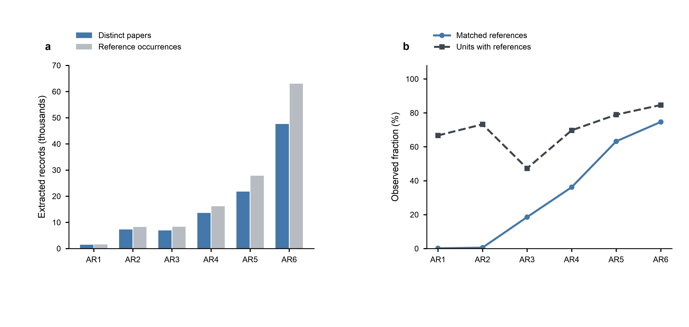
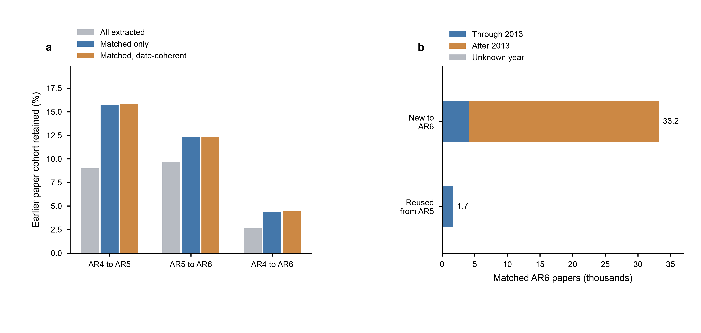
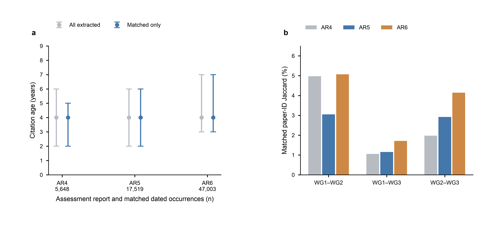
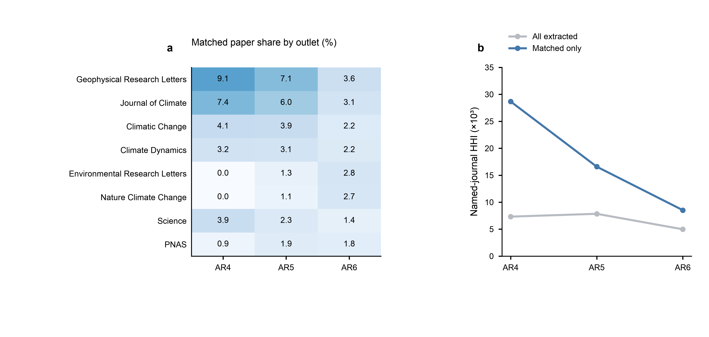

# Literature renewal and working-group structure in IPCC assessment reports

[Jiacheng Zheng](https://karcen.github.io/)\
Ma Yinchu School of Economics, Tianjin University

Working draft and work with ChatGPT 6.1 Sol

[PDF](paper.pdf) [LaTeX](paper.tex) [BibTeX](references.bib)

## Abstract

IPCC assessments update their evidence through successive research generations. This study examines how document renewal relates to citation age and assessment structure in 125,164 extracted reference occurrences from the first six assessment reports. The primary AR5 to AR6 comparison uses records with recorded Web of Science DOI or title matches. AR5 contains 13,510 distinct matched paper IDs and AR6 contains 34,873. Their 1,664 shared IDs give 12.32% retention of AR5 and 4.77% reuse in AR6. Reused documents contribute 2,216 included matched occurrences with an eleven-year median citation age. Newly represented documents contribute 44,787 with a four-year median. Their pooled distribution retains an overall four-year median while the interquartile range shifts from two to six years in AR5 to three to seven in AR6. Retention differs among working groups, and cross-group document sharing is limited. Journal concentration falls from 0.01659 to 0.00852. The incoming cohort spans a broader outlet range, although most of its documents appear in outlets already represented in matched AR5. The extracted matched corpus thus combines a small older reused component with extensive entry of younger documents. Report-specific cohort definitions and preserved raw references make these relationships reproducible.

**Keywords:** IPCC; assessment reports; reference renewal; bibliometrics; working groups; metadata quality

## Introduction

An IPCC assessment has to bring a growing research record into a periodic account of climate change. Each cycle draws on publications that appeared after the previous assessment. It also returns to earlier observations, methods and explanations. In 2023, the Sixth Assessment Report (AR6) Synthesis Report brought together the contributions of three working groups and three special reports ([IPCC 2023](#ref-ipcc2023synthesis)). This sequence links evidence accumulation to assessment continuity: the body of cited documents changes across reports within a continuing account of the same climate system.

Reference lists make part of this process observable. A document that appears in successive reports has continuity at the level of citation identity. A newly represented document marks entry into the later reference set. These changes can occur while a finding, method or research question remains in use. Later studies can develop an earlier explanation, apply it in a new setting or summarize several earlier results. Document continuity and continuity of knowledge therefore operate at different levels. The distinction matters when a bibliography is used to describe how an assessment updates its evidence.

The size of climate research increases the demands on this updating process. Callaghan et al. ([2021](#ref-callaghan2021evidence)) mapped evidence from 100,000 climate-impact studies with machine-assisted methods. Their analysis found differences between where research documents impacts and where people are exposed to climate change. A systematic adaptation stocktake screened more than 48,000 records and synthesized 1,682 studies of implemented responses ([Berrang-Ford et al. 2021](#ref-berrangford2021stocktake)). It found that reported responses were often local and incremental, while evidence of risk reduction was sparse. These findings show why publication growth alone cannot establish the coverage of climate impacts or the effectiveness of responses.

Uneven research attention also appears across policy problems. A systematic map of 84,990 climate-policy papers identifies disparities between research attention, implemented policy density and emissions ([Callaghan et al. 2025](#ref-callaghan2025policymap)). A reference set can expand while still giving different weight to sectors, instruments and locations. Evidence updating therefore includes changes in the composition of represented research. Ford et al. ([2025](#ref-ford2025syntheses)) argue for transparent, timely and reproducible knowledge synthesis in climate assessments. Their proposal treats evidence organization as a continuing research task alongside the production of individual studies.

The IPCC distributes that task across assessment functions. Working Group I (WGI) assesses the physical science basis. Working Group II (WGII) assesses impacts, adaptation and vulnerability. Working Group III (WGIII) assesses mitigation ([IPCC 2022a](#ref-ipcc2022wg2), [2022b](#ref-ipcc2022wg3), [2023](#ref-ipcc2023synthesis)). A physical process, an observed social impact and a mitigation option call for different forms of evidence. At the same time, questions about risk and response connect the working groups. Their bibliographies thus offer two related views of assessment structure: the documents that remain within a function across cycles, and the documents shared across functions within a cycle.

The division of work also affects the knowledge needed for assessment. Adaptation research includes evidence on hazards, exposure, institutions and implemented responses. Nalau et al. ([2024](#ref-nalau2024assessment)) distinguish the knowledge selected for adaptation assessment from the practices used to assess it. Their perspective identifies differences among regional chapters and argues for closer attention to implementation knowledge. The document types represented in a bibliography are consequently part of the question. A journal-based reference set can record the scholarly component of assessment while reports and other sources carry additional forms of evidence.

Assessment practice determines how these sources are brought together. Recent proposals examine alternative institutional pathways for the IPCC and greater reflexivity in knowledge co-production ([Asayama et al. 2023](#ref-asayama2023pathways); [Mochizuki and Wada 2023](#ref-mochizuki2023reflexivity)). These arguments connect evidence organization with participation and the relationship to decision-making. Experience from technical support units adds a concern with recognition and institutional memory across cycles ([Slade et al. 2024](#ref-slade2024lessons)). A bibliography supplies a documentary record alongside these organizational accounts. It locates the sources that recur, their temporal composition and their distribution among assessment functions.

The distinction between available research and assessed research has also been examined directly. Montfort et al. ([2025](#ref-montfort2025urban)) mapped 53,295 urban climate studies and compared this wider literature with AR6 references across working groups. They found topical, geographic and disciplinary differences in representation. Their comparison establishes the value of an external literature benchmark. A comparison between successive assessment bibliographies addresses a complementary question: how the documents represented within the assessment change over time.

Prior bibliometric work already establishes substantial renewal in recent IPCC literature. Huang et al. ([2023](#ref-huang2023ar5ar6)) compare WGI references in AR5 and AR6 and find an influx of recent studies alongside continued use of earlier work. That comparison makes publication vintage central to the interpretation of renewal. The remaining problem is how this pattern relates to changes across the working groups and to the typical age of citations. An assessment can retain few particular documents and still cite research at a similar distance from publication. A small retained component can preserve older literature while newly represented documents account for most citations. Resolving these relationships requires common cohort rules and explicit counting units.

The relevant unit changes with the question. Distinct cited documents describe membership in a report’s literature cohort. Reference occurrences describe how often those documents appear across extracted assessment units. The age of an occurrence is measured against the publication date of its source. Journal-title shares describe the distribution of distinct documents among recorded outlets. A reference count alone combines membership and repetition. Source dates place citations from different assessment cycles on a common age scale. Keeping these quantities separate allows turnover, citation age and outlet structure to be compared directly.

The observed reference population also depends on the bibliographic workflow. Liu ([2023](#ref-liu2023retrieval)) shows that retrieval choices affect apparent growth in climate bibliometric studies. Culbert et al. ([2025](#ref-culbert2025coverage)) compare major bibliographic databases and find comparable average reference coverage in a cleaned shared corpus, alongside differences in selected metadata. Their findings make corpus construction part of the research design. In the present database, extraction creates reference occurrences, record linkage assigns paper identities and Web of Science matching identifies a selected subset. Each operation changes what can be counted. Raw reference entries provide the evidence needed to review those assignments.

This study examines 125,164 extracted reference occurrences from the first six IPCC assessment reports. AR5 and AR6 form the main comparison because their matching coverage is much higher than in the early reports. The analysis first measures distinct-document retention and reuse. It then separates the later cohort by earlier representation and publication vintage. Occurrence-level citation ages establish how that turnover relates to recency. Within-group comparisons and cross-group sharing locate continuity within assessment functions. Journal concentration connects the entry of documents with changes in the recorded outlet mix. These linked analyses address how a periodic assessment renews its cited documents while maintaining a temporally structured and functionally differentiated evidence base.

## Data and methods

The source is the SQLite snapshot distributed with `ipcc_litdb`. It was created on 6 October 2026 and packaged on 11 October 2026. It contains 113,591 paper records, 160,029 reference occurrences, 36 report records and 677 catalogue units. Selection of occurrences linked to AR1 to AR6 catalogue units gives 125,164 occurrences and 93,430 distinct paper IDs. Catalogue units include chapters, front matter and annexes. Units with recorded occurrences describe the database inventory. Their proportion depends in part on the types of units included in the catalogue.

A reference occurrence is one extracted bibliography entry in a catalogue unit. A report cohort is the set of distinct linked paper IDs represented in that report. Repeated occurrences count once for cohort membership and retain their separate weights for citation age. The primary matched cohort includes an ID when at least one occurrence in the relevant report has status `matched_doi` or `matched_title`. These statuses record the Web of Science matching workflow. Membership is determined separately for each report. Matched occurrence counts and distinct matched IDs consequently have different denominators ([Table 2](#table-2)).

Let $P_a$ and $P_b$ be the distinct-ID cohorts in an earlier and later report, and let $S=|P_a\cap P_b|$. Retention, reuse and Jaccard overlap are

$$
R_{a\rightarrow b}=\frac{S}{|P_a|},\qquad
U_{a\rightarrow b}=\frac{S}{|P_b|},\qquad
J_{ab}=\frac{S}{|P_a\cup P_b|}.
$$

Retention measures the share of the earlier cohort represented later. Reuse measures the share of the later cohort represented earlier. Jaccard measures the shared fraction of their union. An AR6 ID is newly represented when it belongs to $P_{\mathrm{AR6}}\setminus P_{\mathrm{AR5}}$. Its preferred publication year, `year_best`, places it through 2013, after 2013 or in an unknown-year group. The 2013 boundary is a descriptive split; AR5 working-group contributions have different publication schedules, including contributions published in 2014.

Citation age is the publication year of the source linked to the occurrence’s catalogue unit minus `year_best`. A source date is accepted when it contains exactly one four-digit year. Every selected occurrence has a usable source year in this snapshot, so the available report-level fallback is unused. Included ages run from zero to sixty years. Missing preferred years, years after the source date and ages above sixty are counted separately. Medians and quartiles summarize occurrence-weighted ages. Quartiles use Python’s exclusive `statistics.quantiles` method. The AR6 age decomposition assigns each matched occurrence to the reused or newly represented report-level ID cohort.

Working-group subsets use catalogue labels `WG1`, `WG2` and `WG3`. Combined-group and synthesis units remain in report cohorts and are excluded from pairwise working-group comparisons. An ID can belong to several groups. Within-group continuity compares the same group in AR5 and AR6 using report-specific matched occurrences. Cross-group overlap compares matched sets within a report. The overlap coefficient divides shared IDs by the smaller group size; it reports the fraction of that group also represented in the other. These definitions distinguish continued representation in the same assessment function from representation anywhere in the earlier report.

Journal-title analysis casefolds names and collapses whitespace. It retains recorded abbreviations and title variants. For $N$ distinct IDs with named outlets, the share of title $j$ is $p_j=n_j/N$. Concentration is measured as

$$
H=\sum_j p_j^2.
$$

The reciprocal $1/H$ is the number of equally represented labels with the same concentration. Missing titles are reported outside this denominator. The reused and incoming AR6 subsets use the same rule. Some full-extracted journal fields contain publisher or review-service names; the matched cohort reduces this heterogeneity. Outlet labels and working-group responsibilities provide recorded publication and assessment structure. Formal discipline membership requires separate subject metadata.

The analysis enumerates the extracted population and reports descriptive comparisons. It reads the snapshot without changing it, records the input SHA-256 hash, and exports SQL, cohort membership and occurrence-level source data. Four figures use PDF and SVG vector exports and 600-dpi PNG. Their age intervals are interquartile ranges. The extension script reproduces the reused/incoming decomposition and within-group comparisons, with checks against the original report totals.

Sensitivity comparisons include the full extracted population, chronologically coherent matched cohorts, paper-level verification-status subsets and main-working-group units. Chronological coherence requires at least one selected occurrence with a valid preferred year no later than its source year. Date review compares preferred years with source years and with the stored `parsed_year` field. These rules produce review candidates for record adjudication. Raw-reference inspection also identifies an unmatched ID linked to several different documents (Appendix B). The preserved entries make identity assignments directly inspectable alongside the set-based results.

## Results

The observed population expands substantially between AR5 and AR6. AR5 contains 27,851 reference occurrences linked to 21,770 distinct paper IDs. AR6 contains 63,027 occurrences linked to 47,636 IDs ([Fig. 1a](#figure-1)). Their occurrence matching fractions are 63.21% and 74.66%. Earlier reports have much lower fractions: 0.13% in AR1, 0.52% in AR2 and 18.54% in AR3 ([Fig. 1b](#figure-1)). These coverage differences establish AR5 and AR6 as the main comparison. The report counts describe the assembled snapshot, in which source coverage, extraction and bibliographic matching jointly determine the observed population.

The matched AR6 cohort is 2.58 times the size of matched AR5. It contains 34,873 distinct IDs, compared with 13,510 in AR5. The cohorts share 1,664 IDs. This gives 12.32% retention of AR5, 4.77% reuse in AR6 and 3.56% Jaccard overlap ([Table 3](#table-3)). Retention and reuse describe the same shared set from different directions. The much larger later denominator explains their different magnitudes. Most matched AR5 IDs leave the later matched cohort, while most matched AR6 IDs enter it.

**Figure 1.** **Extracted corpus and matching context.** **a**, Distinct paper IDs and reference occurrences in AR1 to AR6. **b**, The fraction of occurrences with recorded DOI or title matches to Web of Science, and the fraction of catalogue units containing occurrences. Catalogue units include front matter and annexes. Counts describe the extracted snapshot. Source tables: `coverage.csv` and `coverage_by_report_wg.csv`.

The 33,209 newly represented AR6 IDs include earlier publications. Of this set, 29,044 have preferred publication years after 2013, 4,160 have years through 2013 and five have unknown years ([Fig. 2b](#figure-2)). Earlier publications account for 12.53% of newly represented IDs. Their entry makes renewal a change in the composition of cited documents across assessment cycles. New representation in a report and recent publication are separate properties. Among the 1,664 reused IDs, 1,650 have years through 2013 and fourteen have later preferred years.

Basic date screening leaves the measured continuity almost unchanged. The chronologically coherent matched cohorts share 1,653 IDs, with 12.29% retention and 4.74% reuse. The full extracted cohorts share 2,103 IDs, with 9.66% retention and 4.41% reuse. The date rule therefore has a small effect within the matched population, while broadening the population changes retention more appreciably. AR4-to-AR5 matched retention is 15.75%, and AR4-to-AR6 retention is 4.39% ([Fig. 2a](#figure-2)). AR4’s lower matching coverage makes these longer comparisons historical context for the main result.

**Figure 2.** **Paper-cohort continuity and publication vintage.** **a**, Earlier-cohort retention in three report comparisons. The cohorts include all extracted IDs, IDs with matched occurrences, and IDs with matched chronologically coherent occurrences. **b**, Matched AR6 IDs partitioned by representation in matched AR5 and by preferred publication year. The descriptive year split is through 2013 versus after 2013. Five newly represented IDs have unknown years. Source tables: `transitions.csv` and `ar6_vintage_summary_matched.csv`.

Document turnover coexists with a stable median citation age. Dated matched occurrences have a median age of four years in both AR5 and AR6. Their interquartile ranges move from two to six years in AR5 to three to seven years in AR6 ([Fig. 3a](#figure-3)). The median stays fixed while the middle half of the distribution shifts towards older citations. AR5 contributes 17,519 included occurrences, and AR6 contributes 47,003. Age exclusions are small in the matched comparison: five missing years in each report, eighty preferred years after the source date in AR5 and forty-five in AR6 ([Table 4](#table-4)).

The decomposition by AR5 representation explains the aggregate AR6 median. Reused IDs contribute 2,216 included matched occurrences, with a median age of eleven years and an interquartile range of nine to thirteen. Newly represented IDs contribute 44,787, with a median age of four and an interquartile range of three to six ([Table 1](#table-1)). The older reused component forms 4.71% of included AR6 occurrences. The large incoming component occupies the centre of the age distribution. AR6 therefore combines a small older component that remains represented across cycles with a much larger component of recently published citations.

Continuity also varies by assessment function. Within the same working group across AR5 and AR6, WGI retains 811 of 5,606 matched IDs, or 14.47%. WGII retains 511 of 6,424, or 7.95%. WGIII retains 175 of 2,142, or 8.17% ([Table 5](#table-5)). Their later-cohort reuse shares are 6.80%, 3.02% and 2.02%, respectively. Physical-science references have greater within-group continuity under this rule. Each AR6 working group nevertheless has a four-year median citation age and an interquartile range of three to seven years. Different levels of document retention thus coexist with similar central citation ages across the three assessment functions.

Within AR6, reference sharing is greatest between WGI and WGII and lowest between WGI and WGIII. Their matched sets contain 11,923, 16,897 and 8,660 IDs, respectively. WGI and WGII share 1,391 IDs, giving 5.07% Jaccard overlap. WGI and WGIII share 346, giving 1.71%. WGII and WGIII share 1,017, giving 4.14% ([Fig. 3b](#figure-3)). Relative to the smaller group in each pair, the shared IDs account for 11.67%, 4.00% and 11.74%, respectively. The union and smaller-group denominators thus give complementary views of the same shared documents. Cross-group membership and within-group retention together place continuity at the level of particular assessment functions.

**Figure 3.** **Citation age and working-group reference sharing.** **a**, Median citation age and interquartile range for included occurrences aged zero to sixty years. Grey marks summarize all extracted occurrences; blue marks summarize matched occurrences. Numbers below report labels give included matched occurrence counts. **b**, Pairwise Jaccard overlap of matched paper-ID sets within AR4 to AR6 working groups. Intervals in panel a describe the observed age distribution. Source tables: `citation_age.csv`, `citation_age_matched.csv` and `working_group_overlap_matched.csv`.

The recorded outlet distribution becomes less concentrated. Matched AR5 has 1,402 named journal titles across 13,504 IDs. Matched AR6 has 2,524 across 34,853 IDs. Six AR5 IDs and twenty AR6 IDs lack an outlet title. The named-outlet Herfindahl-Hirschman index (HHI) falls from 0.01659 to 0.00852. Its reciprocal rises from 60.29 to 117.33 equally represented outlet labels ([Fig. 4b](#figure-4)). The full extracted cohorts show the same direction, with HHI falling from 0.00785 to 0.00498.

The incoming cohort accounts for the broader AR6 outlet distribution. Reused IDs occupy 336 named titles and have an HHI of 0.03211. Newly represented IDs occupy 2,495 and have an HHI of 0.00802. Their effective outlet counts are 31.14 and 124.67 ([Table 1](#table-1)). The incoming set is much larger and less concentrated across the recorded titles. The retained set places more of its weight in a smaller group of outlets. These component differences connect document renewal with the report-wide concentration result.

Document renewal also occurs within outlets already represented in AR5. Among incoming IDs with a named outlet, 27,107 of 33,189, or 81.67%, appear in 930 titles present in the matched AR5 cohort. The other 6,082 occur in 1,565 titles absent from that cohort. Report-wide, 82.55% of known-outlet AR6 IDs appear in titles already represented in matched AR5. Extensive turnover in paper identities therefore coexists with substantial continuity in publication outlets. Entry includes new documents in familiar outlets alongside documents in additional recorded titles.

Changes in leading outlets give the concentration shift a concrete form. Among all matched IDs, the share of *Geophysical Research Letters* falls from about 7.1% in AR5 to 3.6% in AR6. *Journal of Climate* falls from 6.0% to 3.1%. *Environmental Research Letters* rises from 1.3% to 2.8%, and *Nature Climate Change* rises from 1.1% to 2.7% ([Fig. 4a](#figure-4)). The leading-outlet display and the full HHI address different scales of the same distribution. Together they show redistribution among familiar titles alongside entry of a wider recorded outlet range.

**Figure 4.** **Journal composition and concentration.** **a**, Shares of all matched paper IDs in eight outlets selected by pooled matched report-paper counts across AR4 to AR6. PNAS denotes *Proceedings of the National Academy of Sciences*. **b**, Herfindahl-Hirschman concentration among all named journal titles, shown for extracted and matched cohorts. The axis expresses HHI multiplied by $10^3$. Missing journal titles are excluded from the HHI denominator and reported in the text. Source tables: `journal_mix_matched.csv`, `journal_concentration.csv` and `journal_concentration_matched.csv`.

| Measure                        | Reused from AR5 | Newly represented in AR6 |
|:-------------------------------|----------------:|-------------------------:|
| Distinct paper IDs             |           1,664 |                   33,209 |
| Included age occurrences       |           2,216 |                   44,787 |
| Median citation age (years)    |              11 |                        4 |
| Interquartile range (years)    |         9 to 13 |                   3 to 6 |
| IDs with a named outlet        |           1,664 |                   33,189 |
| Named outlet labels            |             336 |                    2,495 |
| Journal-title HHI              |         0.03211 |                  0.00802 |
| Effective outlet count ($1/H$) |           31.14 |                   124.67 |

**Table 1.** Matched AR6 decomposed by representation in the matched AR5 cohort. Distinct IDs define representation. Age statistics use matched reference occurrences aged zero to sixty years. HHI uses IDs assigned to a named outlet.

## Discussion

The AR5 to AR6 comparison shows that a continuing assessment can draw on a substantially different set of cited documents. The reused component is older and more concentrated across outlet titles. The incoming component supplies most included citation occurrences and spans a broader recorded outlet distribution. Their combination explains the coexistence of extensive document renewal, a four-year median citation age and lower journal concentration. Assessment continuity can therefore be examined through the relationship between recurring documents and the temporal structure of their replacements.

This decomposition develops the recent-versus-earlier literature pattern identified for WGI by Huang et al. ([2023](#ref-huang2023ar5ar6)). Relating publication vintage to cross-report identity and source-relative citation age distinguishes the older reused component from the much larger incoming cohort. It also identifies earlier publications that enter the later cohort for the first time under the selected database rule.

The retained component has a distinct temporal role. Its eleven-year median age in AR6 places it well beyond the centre of the incoming citation distribution. These recurring documents connect the bibliography to earlier research. Their scientific role depends on their use in the assessment text: a repeated citation can support a method, a historical comparison, an observation or a claim. Classifying those uses would connect documentary persistence to the forms of scientific continuity carried by the retained set. For sea-level assessments, Kopp et al. ([2023](#ref-kopp2023uncertainty)) examine the treatment of quantifiable and unquantifiable uncertainty. Their review shows why the interpretation and communication of evidence matter to assessment conclusions.

Direct references capture one route through which earlier research enters an assessment. Reviews also connect an assessment to the studies they synthesize. In the urban climate literature, Montfort et al. ([2025](#ref-montfort2025urban)) estimate that AR6 directly represented 4.6% of their identified literature and covered a further 2.1% through studies cited by included reviews. This second-order representation supplies an empirical example of knowledge reaching an assessment through a different cited document. Adding the cited sources of reviews would extend the present report-to-document network into that additional layer.

Nearly all included AR6 occurrences belong to documents absent from the matched AR5 cohort. Their age distribution has a four-year median and an interquartile range of three to six years. Pooling these occurrences with the older reused component leaves the median at four years and raises the upper quartile to seven. The overall interquartile range of three to seven years shows how a stable median coexists with a change in the middle spread of citation ages. Median recency and documentary persistence describe separate features of evidence updating.

The entry of 4,160 earlier publications gives renewal a second temporal dimension. A later assessment can incorporate literature that already existed around the previous cycle. This pattern is consistent with changes in the subjects assessed, the coverage of extracted sources and the success of record matching. The observed cohort combines these processes. Distinguishing their contributions requires a source-list inventory and comparison of the assessment passages that use the added documents. This would identify whether an earlier publication enters through a newly assessed question, a changed treatment of an existing question or a changed database assignment.

Working-group differences show that renewal has an organizational structure. WGI retains a larger share of its matched AR5 reference set within the same group than WGII or WGIII. All three groups nevertheless have the same central citation-age statistics in AR6. A common assessment cycle can thus contain different levels of document continuity alongside a similar age profile. The pattern connects the reference analysis with the groups’ different responsibilities: physical explanation, impacts and adaptation, and mitigation ([IPCC 2022a](#ref-ipcc2022wg2), [2022b](#ref-ipcc2022wg3), [2023](#ref-ipcc2023synthesis)). The data establish the differences in document sets. Explaining particular retention decisions requires evidence on their chapter-level uses.

Cross-group sharing locates a further layer of integration. WGI and WGII share a greater fraction of their combined matched IDs than WGI and WGIII. WGII and WGIII occupy an intermediate position. This ordering establishes unequal sharing of cited documents across the group pairs. A common document is one route through which knowledge can connect assessment functions. The groups can also use different publications to address a common risk, method or response. The distinction between what is assessed and how it is assessed, developed by Nalau et al. ([2024](#ref-nalau2024assessment)), directs attention to the use and evaluation of evidence within chapters. Comparing shared concepts and their assessment uses would test whether low document overlap accompanies a wider set of substantive connections.

Common assessment frameworks provide another route across the working groups. Scenarios relate physical projections, impacts and response pathways within consistent accounts of possible futures ([Pirani et al. 2024](#ref-pirani2024scenarios)). Atlas development offers a concrete example of data coordination: early access to the WGI Interactive Atlas supported climate-hazard analyses in the other groups ([Alegría et al. 2024](#ref-alegria2024atlas)). The proposed integrated atlas also addresses differences in spatial scale and data formats. These examples identify connections carried by shared frameworks and data use. A reference network can be extended with those relationships to examine how differentiated bibliographies contribute to a combined assessment.

The outlet decomposition connects document renewal with report-wide outlet composition. The less concentrated incoming AR6 cohort dominates the report-wide distribution, although most of its documents appear in outlets represented in matched AR5. Renewal therefore combines replacement within an existing publication structure with entry into additional recorded titles. Changes in the leading-outlet shares show that the weights within that structure also move. The larger outlet range and lower HHI describe this changing mix. Formal disciplinary diversity would require subject classifications, and geographic representation would require affiliation and location data. Huang et al. ([2024](#ref-huang2024openaccess)) distinguish the diversity of citing institutions, countries and fields from citation volume. These dimensions would extend the present analysis beyond its recorded outlet labels.

Document frequency and the influence of evidence on an assessed result are separate quantities. Sognnaes and Peters ([2025](#ref-sognnaes2025influence)) examine how removing individual models or studies changes statistics derived from the AR6 mitigation scenario ensemble. Their empirical comparison locates influence in the assessment calculation. A systematic review of carbon pricing similarly pools 483 effect sizes from eighty evaluations of twenty-one schemes ([Döbbeling-Hildebrandt et al. 2024](#ref-dobbeling2024carbonpricing)). The number of documents, the number of evaluated settings and the weight of evidence each have a defined role. In the present study, paper membership measures documentary representation, and occurrence counts measure representation across extracted units. Connecting these records to assessed claims would add a direct measure of their substantive contribution.

Literature supply, bibliographic coverage and assessment selection jointly determine the observed outlet pattern. More publications in a field can create more candidates for citation. A change in assessment scope can increase their relevance. A matching service can also represent some publication types more readily than others. Liu ([2023](#ref-liu2023retrieval); [Culbert et al. 2025](#ref-culbert2025coverage)) show why database and retrieval choices belong in the interpretation of bibliometric populations. The report-wide and within-group results in this study use recorded match status to make that selection explicit. An audited comparison with original reference lists would separate changes in the assessment bibliography from changes in its database representation.

Record identity directly affects the measured continuity. The raw-reference review found a preferred encyclopedia entry linked to several distinct government reports and other documents. A shared ID produced by such a merge gives a false appearance of recurrence. Splitting one document across several IDs produces the opposite effect. The primary matched rule reduces reliance on the unmatched records in which this case appears. A stratified sample checked against original entries would estimate both types of linkage error by report and match status, and establish how much of the measured shared set survives document-level adjudication. Sietsma et al. ([2024](#ref-sietsma2024tracking)) call for diverse training data, explicit hypotheses and attention to bias in machine-assisted tracking of adaptation. Their recommendations support making the data and assumptions of automated expansion explicit. Record-level validation would supply reviewed examples for that work.

These relationships give transparent synthesis a concrete bibliographic task. The practices proposed by Ford et al. ([2025](#ref-ford2025syntheses)) include traceable and reproducible organization of evidence. Continuously updated evidence syntheses have also been proposed to shorten the interval between new research and organized evidence ([Elliott et al. 2021](#ref-elliott2021living)). Such updates require a dated record of additions and corrections. A report-to-document database records the selection outcome and preserves the original entry behind each assigned identity. It can support review of additions, recurring sources and gaps across assessment units. The institutional questions raised by Asayama et al. ([2023](#ref-asayama2023pathways); [Mochizuki and Wada 2023](#ref-mochizuki2023reflexivity)) become more tractable when the relevant evidence choices can be located and inspected. The institutional memory discussed by Slade et al. ([2024](#ref-slade2024lessons)) concerns people and practices across assessment cycles. Documentary recurrence supplies a separate record of which cited sources remain represented. Connecting these two records would show how assessment teams preserve, revisit and revise the use of earlier evidence.

The extracted matched corpus shows renewal with a distinct temporal and organizational structure. A small older component recurs across AR5 and AR6, while a much larger incoming component accounts for the recent citation-age median and less concentrated outlet mix. Working groups retain different proportions of their earlier documents and share limited fractions of their within-cycle reference unions. These counting relationships describe how the cited record changes. Linking them to assessment passages would establish how recurring and newly represented documents contribute to the continuity of assessed knowledge.

## Data and code availability

The database snapshot and toolkit are available at <https://github.com/Karcen/ipcc_litdb>. The manuscript package contains the analysis and plotting scripts, SQL, source CSVs, derived results, figure exports and reference-verification records. The analysis verifies the database checksum before and after reading it. The manuscript package is supplied with this draft and can be archived with a fixed release for publication.

## References

Alegría, Andrés, Elvira Poloczanska, Sina Loeschke, Katja Mintenbeck, and Hans Poertner. 2024. “Towards an IPCC Atlas for comprehensive climate change risk assessments.” *npj Climate Action* 3 (1): 108. <https://doi.org/10.1038/s44168-024-00193-3>.

Asayama, Shinichiro, Kari De Pryck, Silke Beck, et al. 2023. “Three institutional pathways to envision the future of the IPCC.” *Nature Climate Change* 13 (9): 877–80. <https://doi.org/10.1038/s41558-023-01780-8>.

Berrang-Ford, Lea, A. R. Siders, Alexandra Lesnikowski, et al. 2021. “A systematic global stocktake of evidence on human adaptation to climate change.” *Nature Climate Change* 11 (11): 989–1000. <https://doi.org/10.1038/s41558-021-01170-y>.

Callaghan, Max, Lucy Banisch, Niklas Doebbeling-Hildebrandt, et al. 2025. “Machine learning map of climate policy literature reveals disparities between scientific attention, policy density, and emissions.” *npj Climate Action* 4 (1): 7. <https://doi.org/10.1038/s44168-024-00196-0>.

Callaghan, Max, Carl-Friedrich Schleussner, Shruti Nath, et al. 2021. “Machine-learning-based evidence and attribution mapping of 100,000 climate impact studies.” *Nature Climate Change* 11 (11): 966–72. <https://doi.org/10.1038/s41558-021-01168-6>.

Culbert, Jack H., Anne Hobert, Najko Jahn, et al. 2025. “Reference coverage analysis of OpenAlex compared to Web of Science and Scopus.” *Scientometrics* 130 (4): 2475–92. <https://doi.org/10.1007/s11192-025-05293-3>.

Döbbeling-Hildebrandt, Niklas, Klaas Miersch, Tarun M. Khanna, et al. 2024. “Systematic review and meta-analysis of ex-post evaluations on the effectiveness of carbon pricing.” *Nature Communications* 15 (1): 4147. <https://doi.org/10.1038/s41467-024-48512-w>.

Elliott, Julian, Rebecca Lawrence, Jan C. Minx, et al. 2021. “Decision makers need constantly updated evidence synthesis.” *Nature* 600 (7889): 383–85. <https://doi.org/10.1038/d41586-021-03690-1>.

Ford, James D., Robbert Biesbroek, Lea Berrang Ford, et al. 2025. “Recommendations for producing knowledge syntheses to inform climate change assessments.” *Nature Climate Change* 15 (7): 698–708. <https://doi.org/10.1038/s41558-025-02354-6>.

Huang, Chun-Kai, Cameron Neylon, Lucy Montgomery, et al. 2024. “Open access research outputs receive more diverse citations.” *Scientometrics* 129 (2): 825–45. <https://doi.org/10.1007/s11192-023-04894-0>.

Huang, Tian-Yuan, Liangping Ding, Yong-Qiang Yu, Lei Huang, and Liying Yang. 2023. “From AR5 to AR6: exploring research advancement in climate change based on scientific evidence from IPCC WGI reports.” *Scientometrics* 128 (9): 5227–45. <https://doi.org/10.1007/s11192-023-04788-1>.

IPCC. 2022a. *Climate Change 2022: Impacts, Adaptation and Vulnerability. Contribution of Working Group II to the Sixth Assessment Report of the Intergovernmental Panel on Climate Change*. Cambridge University Press. <https://doi.org/10.1017/9781009325844>.

IPCC. 2022b. *Climate Change 2022: Mitigation of Climate Change. Contribution of Working Group III to the Sixth Assessment Report of the Intergovernmental Panel on Climate Change*. Cambridge University Press. <https://doi.org/10.1017/9781009157926>.

IPCC. 2023. *Climate Change 2023: Synthesis Report. Contribution of Working Groups I, II and III to the Sixth Assessment Report of the Intergovernmental Panel on Climate Change*. Intergovernmental Panel on Climate Change. <https://doi.org/10.59327/IPCC/AR6-9789291691647>.

Kopp, Robert E., Michael Oppenheimer, Jessica L. O’Reilly, et al. 2023. “Communicating future sea-level rise uncertainty and ambiguity to assessment users.” *Nature Climate Change* 13 (7): 648–60. <https://doi.org/10.1038/s41558-023-01691-8>.

Liu, Fang. 2023. “Retrieval strategy and possible explanations for the abnormal growth of research publications: re-evaluating a bibliometric analysis of climate change.” *Scientometrics* 128 (1): 853–59. <https://doi.org/10.1007/s11192-022-04540-1>.

Mochizuki, Junko, and Yoshihide Wada. 2023. “Closing the loop of reflexivity.” *Nature Climate Change* 13 (2): 110–12. <https://doi.org/10.1038/s41558-022-01569-1>.

Montfort, Simon, Max Callaghan, Felix Creutzig, et al. 2025. “Systematic global stocktake of over 50,000 urban climate change studies.” *Nature Cities* 2 (7): 613–25. <https://doi.org/10.1038/s44284-025-00260-8>.

Nalau, Johanna, Elisabeth Gilmore, and Mark Howden. 2024. “Improving adaptation assessment in the IPCC.” *npj Climate Action* 3 (1): 76. <https://doi.org/10.1038/s44168-024-00155-9>.

Pirani, Anna, Jan S. Fuglestvedt, Edward Byers, et al. 2024. “Scenarios in IPCC assessments: lessons from AR6 and opportunities for AR7.” *npj Climate Action* 3 (1): 1. <https://doi.org/10.1038/s44168-023-00082-1>.

Sietsma, Anne J., James D. Ford, and Jan C. Minx. 2024. “The next generation of machine learning for tracking adaptation texts.” *Nature Climate Change* 14 (1): 31–39. <https://doi.org/10.1038/s41558-023-01890-3>.

Slade, Raphael, Minal Pathak, Sarah Connors, Melinda Tignor, Andrew Emmanuel Okem, and Noëmie Leprince-Ringuet. 2024. “Back to basics for the IPCC: applying lessons from AR6 to the Seventh Assessment Cycle.” *npj Climate Action* 3 (1): 48. <https://doi.org/10.1038/s44168-024-00130-4>.

Sognnaes, Ida, and Glen P. Peters. 2025. “Influence of individual models and studies on quantitative mitigation findings in the IPCC Sixth Assessment Report.” *Nature Communications* 16 (1): 8343. <https://doi.org/10.1038/s41467-025-64091-w>.

## Appendix A. Corpus coverage and sensitivity comparisons

| Report | Occurrences | Distinct IDs | Matched IDs | Matched (%) | Units |
|:-------|------------:|-------------:|------------:|------------:|------:|
| AR1    |       1,551 |        1,448 |           2 |        0.13 | 20/30 |
| AR2    |       8,250 |        7,310 |          40 |        0.52 | 52/71 |
| AR3    |       8,292 |        6,914 |       1,126 |       18.54 | 26/55 |
| AR4    |      16,193 |       13,635 |       4,597 |       36.16 | 46/66 |
| AR5    |      27,851 |       21,770 |      13,510 |       63.21 | 75/95 |
| AR6    |      63,027 |       47,636 |      34,873 |       74.66 | 66/78 |

**Table 2.** Extracted report cohorts. Matching percentages use reference occurrences. Units with occurrences are shown relative to catalogue units.

| Cohort | AR5 | AR6 | Shared | Retention (%) | Reuse (%) | Jaccard (%) |
|:---|---:|---:|---:|---:|---:|---:|
| All extracted | 21,770 | 47,636 | 2,103 | 9.66 | 4.41 | 3.12 |
| Matched occurrences | 13,510 | 34,873 | 1,664 | 12.32 | 4.77 | 3.56 |
| Matched, coherent | 13,447 | 34,839 | 1,653 | 12.29 | 4.74 | 3.54 |
| All, coherent | 20,670 | 46,731 | 1,978 | 9.57 | 4.23 | 3.02 |
| Verified metadata status | 18,902 | 43,396 | 2,035 | 10.77 | 4.69 | 3.38 |
| DOI-verified status | 5,387 | 8,515 | 368 | 6.83 | 4.32 | 2.72 |
| Main WG units, all | 21,767 | 47,636 | 2,103 | 9.66 | 4.41 | 3.12 |

**Table 3.** AR5 to AR6 paper-ID comparisons under alternative cohort rules. Retention uses the AR5 denominator; reuse uses AR6; Jaccard uses the union. Coherent means at least one selected occurrence has a valid preferred publication year no later than the source year. Status subsets refer to paper-level workflow labels.

| Report | Cohort  | Included | Missing year | Future year | Age $>60$ | Median |    IQR |
|:-------|:--------|---------:|-------------:|------------:|----------:|-------:|-------:|
| AR4    | All     |   13,476 |          987 |       1,533 |       197 |      4 | 2 to 6 |
| AR4    | Matched |    5,648 |            5 |         202 |         0 |      4 | 2 to 5 |
| AR5    | All     |   26,232 |          766 |         816 |        37 |      4 | 2 to 6 |
| AR5    | Matched |   17,519 |            5 |          80 |         0 |      4 | 2 to 6 |
| AR6    | All     |   61,474 |          899 |         570 |        84 |      4 | 3 to 7 |
| AR6    | Matched |   47,003 |            5 |          45 |         0 |      4 | 3 to 7 |

**Table 4.** Citation-age inclusion and exclusions. Values count reference occurrences. Future years mean preferred paper years after source publication years. IQR is the interquartile range.

| Group | AR5 papers | AR6 papers | Shared | Retention (%) | Reuse (%) | Jaccard (%) |
|:------|-----------:|-----------:|-------:|--------------:|----------:|------------:|
| WG1   |      5,606 |     11,923 |    811 |         14.47 |      6.80 |        4.85 |
| WG2   |      6,424 |     16,897 |    511 |          7.95 |      3.02 |        2.24 |
| WG3   |      2,142 |      8,660 |    175 |          8.17 |      2.02 |        1.65 |

**Table 5.** Matched paper continuity within the same working group from AR5 to AR6. Retention uses the AR5 group denominator; reuse uses the AR6 group denominator. Working-group cohorts can overlap.

| Group |               AR4 |               AR5 |                AR6 |
|:------|------------------:|------------------:|-------------------:|
| WG1   | 4 (2 to 5); 2,361 | 4 (2 to 6); 7,110 | 4 (3 to 7); 15,223 |
| WG2   | 4 (3 to 5); 2,482 | 4 (3 to 6); 8,154 | 4 (3 to 7); 21,303 |
| WG3   |   4 (2 to 5); 801 | 4 (2 to 6); 2,255 | 4 (3 to 7); 10,477 |

**Table 6.** Matched citation age by working group: median (interquartile range) in years, followed by the dated occurrence denominator. Ages use each source volume’s publication year and include values from 0 to 60 years.

## Appendix B. Raw-reference identity review

Paper ID 2323 has the preferred title *United States*, year 2012 and DOI `10.4135/9781452218564.n707`. Its preferred outlet is *Encyclopedia of Global Warming & Climate Change*; its status is `doi_verified`. Linked unmatched entries include an EPA report on potential climate effects in AR1 to AR3, a 2012 EPA climate-indicator report and a different 2012 document on psychological effects in AR5, and a 2015 EPA report in AR6. These entries identify distinct documents. The preferred encyclopedia metadata cannot represent all of them. This ID is excluded from the matched cohorts. The source CSV retains the original entries and linkage.

The analysis exports 5,367 AR1 to AR6 occurrence-level date-review candidates. They have a preferred year after the source year, a discrepancy between stored parsed and preferred years, or both. Screening generates candidates for adjudication. The preserved snapshot supports comparison with future corrections.
